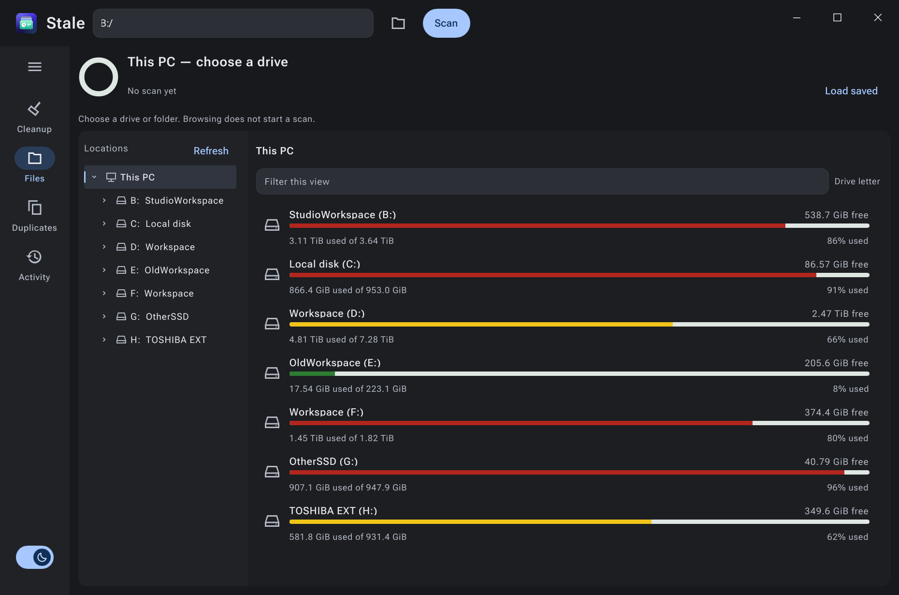
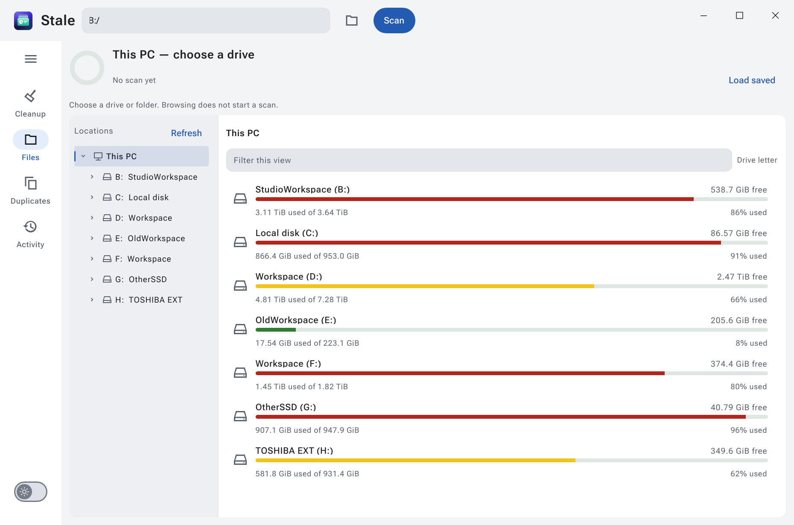
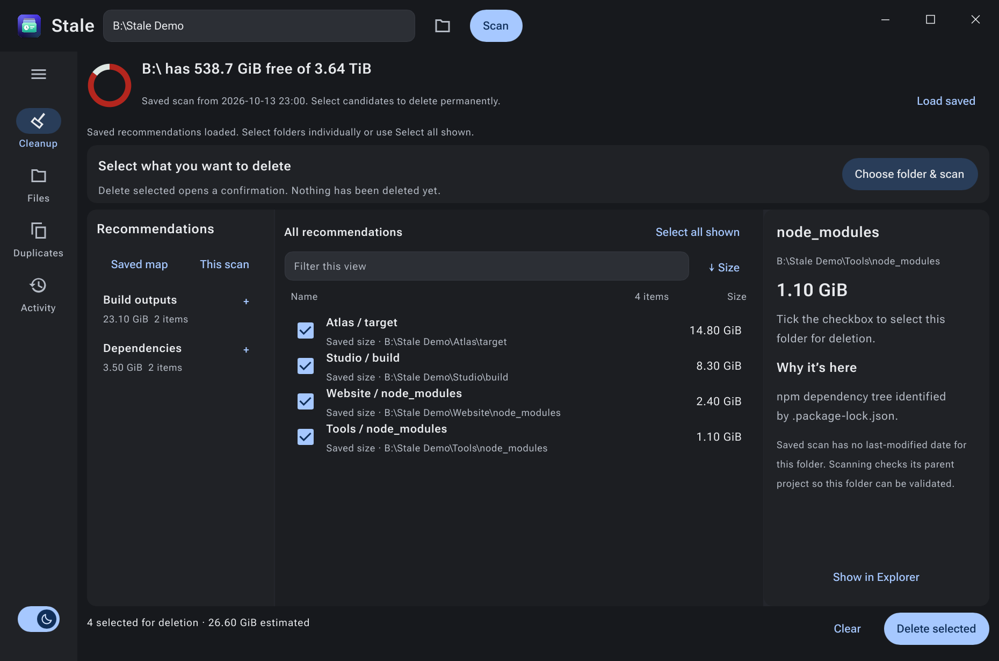

<p align="center">
  
</p>

<h1 align="center">Stale Material</h1>
<p align="center"><strong>Make room for what comes next.</strong><br>Material 3 Expressive on Slint. Native Windows. About 35 MiB at idle.</p>

<p align="center">
  <a href="https://github.com/jethac/stale-material/releases"><strong>Download for Windows</strong></a> &nbsp;·&nbsp;
  <a href="docs/WINDOWS.md">Documentation</a> &nbsp;·&nbsp;
  <a href="desktop/AGENT_API.md">Agent API</a> &nbsp;·&nbsp;
  <a href="CONTRIBUTING.md">Contribute</a>
</p>
<p align="center">
  <a href="https://github.com/jethac/stale-material/actions/workflows/windows.yml"></a>
  
  
  <a href="LICENSE"></a>
</p>

> [!WARNING]
> **Stale Material is a permanent-deletion tool. Use it with care.** Deleted items
> bypass the Recycle Bin, and the app has no undo. Keep backups of anything you
> cannot replace, review the full paths in the confirmation, and do not assume
> that a cleanup recommendation means a folder is disposable. Failed or
> interrupted operations may already have deleted some contents.
>
> Read the [deletion safety audit and known failure modes](docs/DELETION-SAFETY.md)
> before using bulk deletion. Path checks reduce mistakes; they are not a guarantee
> against data loss.

<picture>
  <source media="(prefers-color-scheme: light)" srcset="docs/images/stale-material-light.png">
  
</picture>
<p align="center"><sub>A real app screenshot. Every drive, one overview. Light and dark themes included.</sub></p>

## A clearer view of your storage

Stale Material brings **Material 3 Expressive (M3E) to a native Windows disk explorer**, using the components in **[my Slint fork, jethac/slint](https://github.com/jethac/slint)**. Built with C++ and Slint, it combines an Explorer-style browser with disk analysis, cleanup recommendations, and an interface that people and agents can operate together.

| See the space | Work through it |
| --- | --- |
| **Every drive at a glance** — capacity bars, free space, and percentage used, in drive-letter order. | **Browse before scanning** — expand folders without launching a recursive scan. |
| **Size where it matters** — measure folders, sort results, and inspect what is taking up room. | **Find cleanup candidates** — group build output, dependencies, and caches by category and project. |
| **Material 3 Expressive** — a navigation rail, compact tree, custom title bar, and sun/moon theme switch. | **Tick. Delete. Done.** — select folders with checkboxes, delete in bulk, and confirm once. |

The capacity colors mean the same thing everywhere: **green** below 50% used, **yellow** from 50% to below 75%, and **red** at 75% or more. Unknown sizes stay unknown until measured.

<details>
<summary><strong>See the light theme</strong></summary>



</details>

## Expressive UI. Tiny memory footprint.

**M3E on Slint, without an embedded browser runtime.** The navigation rail, expressive controls, and light/dark themes build on my Slint fork, with custom widgets for storage visualization and Windows window chrome.

In a visible, idle **seven-drive overview**, the Release build used approximately **35 MiB of resident memory** and **15 MiB of private committed memory** on Windows 11. A complete native desktop interface in a surprisingly small footprint.

<sub>Measured with PowerShell `Get-Process` (`WorkingSet64` and `PrivateMemorySize64`), using Slint’s software renderer at a 1240 × 820 logical window size. No scan was loaded. These are an idle snapshot, not a peak-memory benchmark; scanning and larger result sets require more memory. The two metrics describe different things and should not be added together.</sub>

## Get started

1. Download **Stale-Windows-x64.zip** from the [Windows preview releases](https://github.com/jethac/stale-material/releases).
2. Extract the ZIP and run **Stale.exe**, keeping the included DLL beside it.
3. Browse a drive, or choose a folder and select **Scan**. Open **Cleanup** to work through the results.

**Windows 10/11, x64.** Requires the Microsoft Visual C++ x64 runtime. Preview builds are unsigned. Each release includes a SHA-256 checksum and is built and tested on GitHub-hosted runners.

## Made for humans and agents

An agent can navigate the same visible application you use: inspect drives, expand the tree, scan a folder, read results, and open the review dialog. State and results are structured, with stable IDs and stale-view protection.

Agent access is **opt-in**, local, and restricted to the launching Windows user. It cannot confirm deletion.

```powershell
# Start the visible app with a local control endpoint.
.\Stale.exe --agent-pipe desktop

# In another PowerShell window:
.\stale-agent.ps1 -Request '{"action":"browse","path":"this-pc"}'
.\stale-agent.ps1 -Request '{"action":"drives"}'
```

[Read the agent protocol →](desktop/AGENT_API.md)

## Cleanup without the ceremony

**Tick the folders. Click Delete selected. Confirm once.**

Select individual checkboxes, or use **Select all shown** for the current category,
project, or filtered list. Selection is immediate—even with saved recommendations.
The app checks the selected contents when deletion starts, with no separate
“check and select” step.


<p align="center"><sub>Current application UI with illustrative project names and sizes from a demo report. Drive capacity is measured live.</sub></p>

**Permanent deletion is the default.** The confirmation says **Delete permanently**.
Items bypass the Recycle Bin, including folders too large to recycle. This cannot
be undone through the app or the Recycle Bin.

The status line reports the current folder and deletion progress. **Activity**
records successes and failures; a failure does not imply that everything in a
folder remains untouched. After an interrupted or partial operation, rescan to
see what remains.

- Hard-linked build files can be deleted. Other links remain intact, so removing
  one link may not free its underlying storage.
- Protected paths, cloud placeholders, and reparse points can still prevent an
  operation; refusals identify the path and reason where available.
- Saved sizes are estimates from the earlier scan, not guaranteed recoverable space.
- Windows dates mean **last modified**, not “last used.”

See [Windows behavior and current limitations](docs/WINDOWS.md#windows-behavior).
The Windows preview does not yet include automatic updates or a folder-by-folder
interactive ring breakdown.

## Build it

Install Visual Studio with **Desktop development with C++** and CMake tools, plus **Rust 1.95 or newer**.

```powershell
./scripts/build-windows.ps1    # Build the pinned Slint fork, app, CLI, and tests
./scripts/test-agent.ps1      # Exercise the visible app through its agent API
./scripts/package-windows.ps1 # Produce dist/Stale-Windows-x64.zip
```

The first build compiles Slint from source. Subsequent builds reuse the local build tree.

[Build options](docs/WINDOWS.md) · [Semantic commits and release workflow](CONTRIBUTING.md) · [GitHub Actions](https://github.com/jethac/stale-material/actions)

## Roots and credits

Based on **[Stale by Florin Dobinciuc / HustleCoding](https://github.com/HustleCoding/stale)**. The original macOS sources and build remain in this repository; their features differ from the Windows edition. See the [original macOS guide](docs/MACOS.md).

The Windows interface uses **[Slint](https://slint.dev)** through the **[jethac/slint](https://github.com/jethac/slint)** fork, its Material 3 Expressive components, and Roboto Flex. JSON support uses nlohmann/json.

[MIT license](LICENSE) for Stale. Third-party components retain their own licenses; the Windows package includes their notices.
